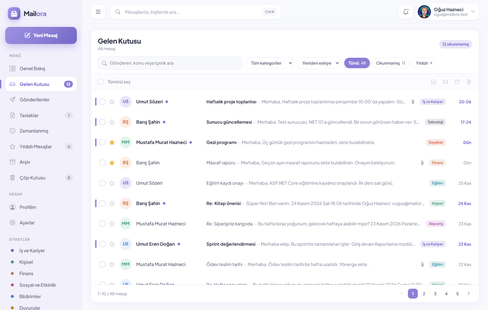
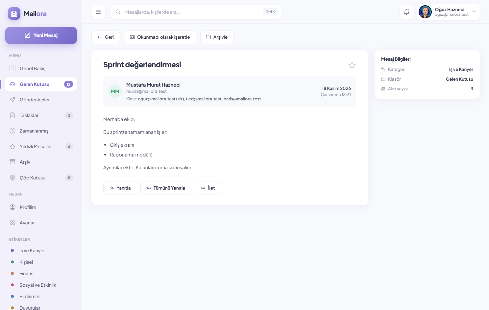
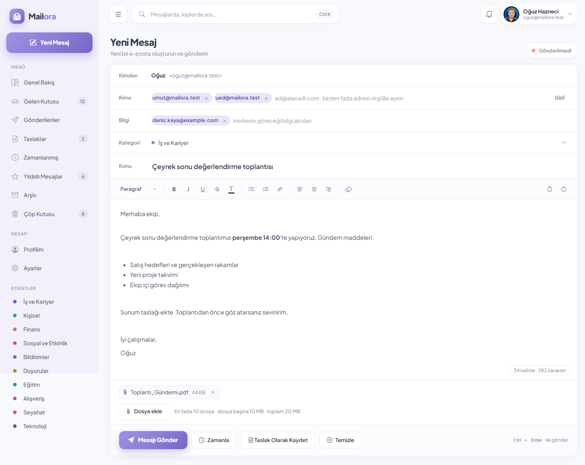
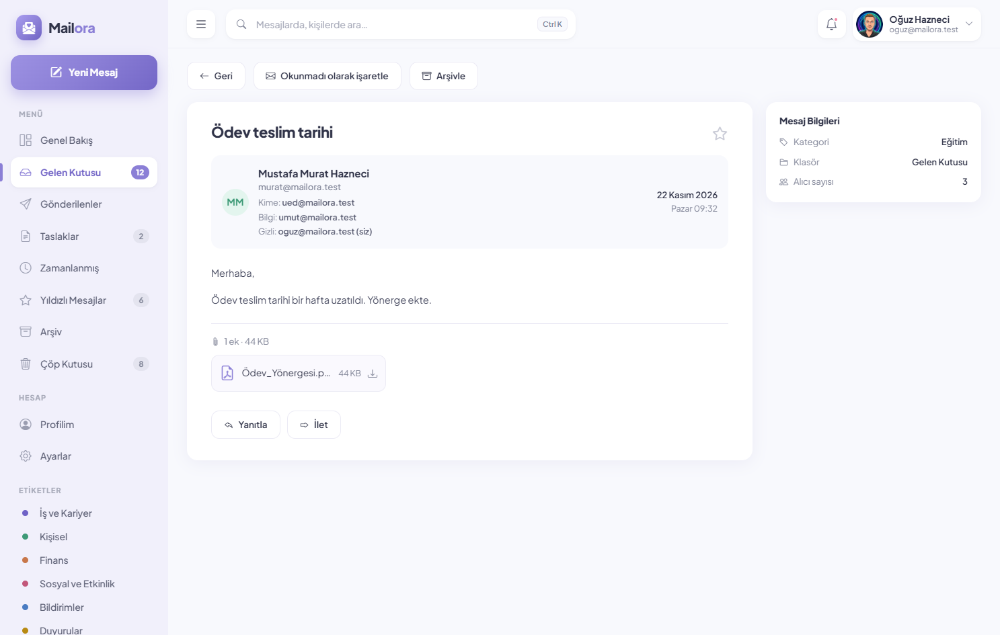
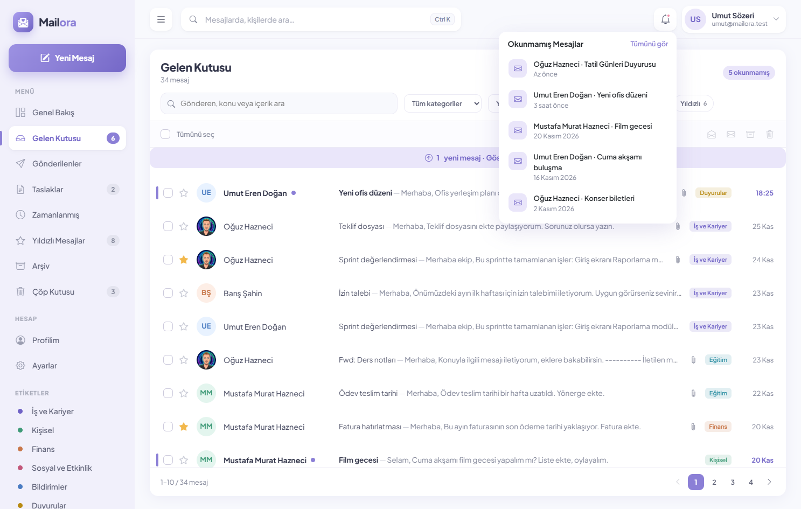
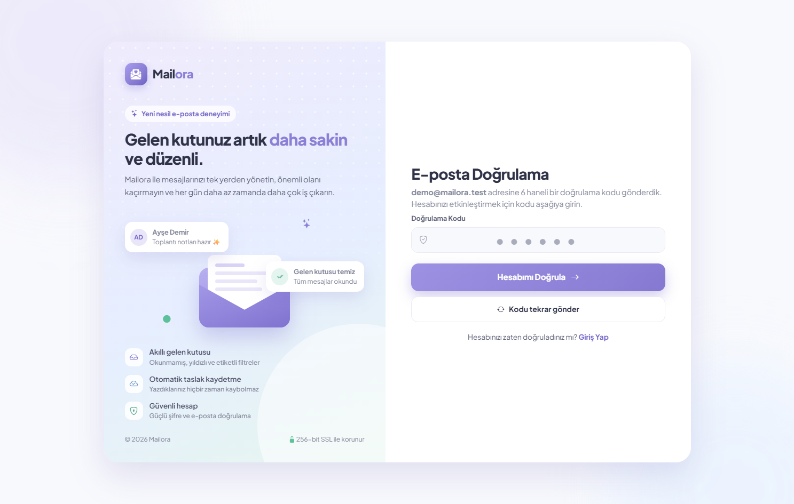
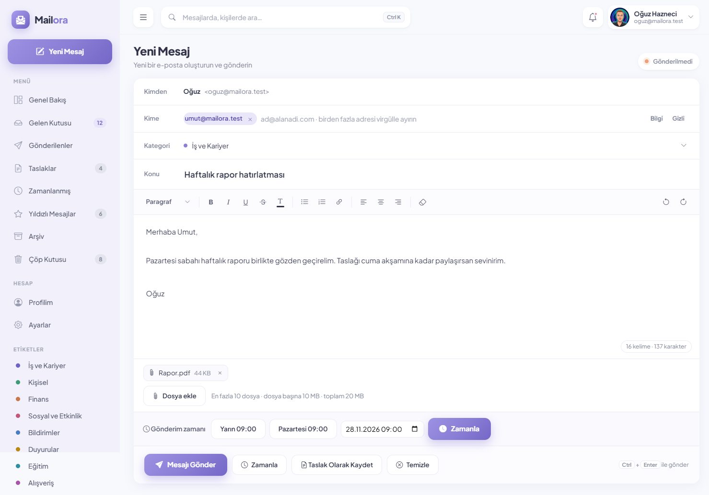
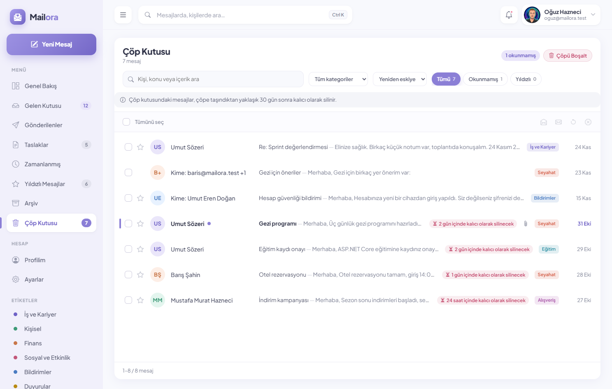
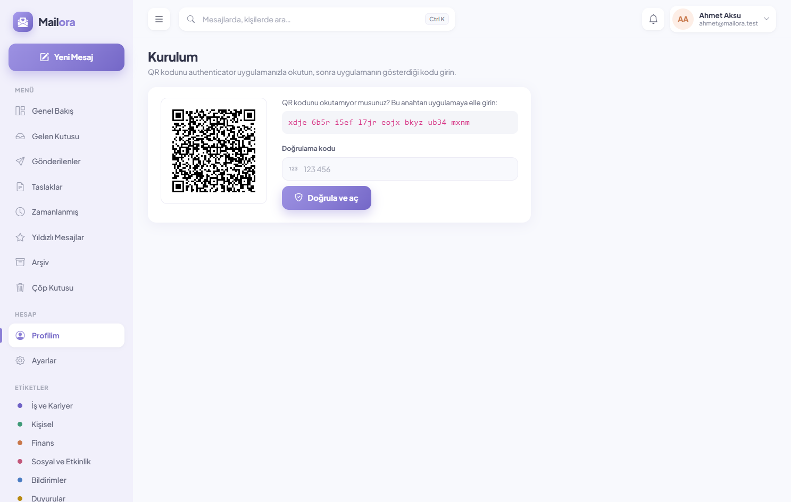

# Mailora · Identity E-Posta Yönetim Sistemi

ASP.NET Core MVC ve ASP.NET Core Identity ile geliştirilmiş, tarayıcı üzerinden çalışan bir e-posta yönetim uygulaması. Kullanıcılar kayıt olur ve hesaplarını e-posta doğrulamasıyla etkinleştirir; isterlerse **iki adımlı doğrulamayı** açar. Birbirlerine **Kime / Bilgi / Gizli** alıcılı ve **ekli** mesajlar gönderir, mesajları ileri bir tarihe **zamanlayabilir**, Mailora dışındaki adreslere SMTP üzerinden e-posta yollayabilirler. Gelen kutusu; arama, filtreleme, arşiv, kendiliğinden boşalan çöp kutusu, taslaklar ve anlık bildirimlerle günlük kullanıma uygun şekilde tasarlandı.

> Bu proje bir bootcamp vaka çalışması olarak geliştirildi. Hedef yalnızca "çalışan" bir uygulama değil; her kararın gerekçesi olan, güvenlik açısından düşünülmüş ve testlerle korunan bir kod tabanıydı. Aşağıdaki [Tasarım kararları](#tasarım-kararları) ve [Güvenlik](#güvenlik) bölümleri bu gerekçeleri özetliyor.

[](https://github.com/oguzhazneci/Mailora/actions/workflows/ci.yml)   

---

## İçindekiler

- [Ekran görüntüleri](#ekran-görüntüleri)
- [Özellikler](#özellikler)
- [Kullanılan teknolojiler](#kullanılan-teknolojiler)
- [Kurulum](#kurulum)
- [E-posta gönderimi: iki çalışma modu](#e-posta-gönderimi-iki-çalışma-modu)
- [Örnek veri seti](#örnek-veri-seti)
- [Testler ve sürekli entegrasyon](#testler-ve-sürekli-entegrasyon)
- [Tasarım kararları](#tasarım-kararları)
- [Güvenlik](#güvenlik)
- [Bilinen sınırlamalar](#bilinen-sınırlamalar)
- [Yayına alma notları](#yayına-alma-notları)
- [Proje yapısı](#proje-yapısı)

---

## Ekran görüntüleri

| | |
|---|---|
|  |  |
| **Genel Bakış:** son 30 günün özeti ve grafikler | **Gelen Kutusu:** arama, kategori ve durum filtreleri, toplu işlemler |
|  |  |
| **Mesaj detayı:** gönderen, alıcılar ve yanıt seçenekleri | **Yeni mesaj:** alıcı kartları, zengin metin editörü, ek yükleme |
|  |  |
| **Gizlilik:** Gizli alıcı yalnızca kendini görür | **Bildirimler:** yeni mesaj sayfa yenilenmeden gelir |
|  |  |
| **Profil:** fotoğraf yükleme ve bilgiler | **Kayıt:** e-posta doğrulama kodu |
|  |  |
| **Zamanlanmış gönderim:** hızlı seçenekler ve tarih seçici | **Çöp kutusu:** 30 gün sonra kalıcı silme, son günlerde uyarı rozeti |
|  |  |
| **İki adımlı doğrulama:** doğrulayıcı uygulamayla QR kodlu kurulum | **Hız sınırlama:** sınır aşılınca ne kadar bekleneceği söylenir |

---

## Özellikler

### Hesap ve kimlik
- Kayıt olma ve **e-posta doğrulama kodu** ile hesap etkinleştirme (kod 5 yanlış denemeden sonra geçersiz olur)
- Giriş / çıkış, **şifremi unuttum** akışı (e-postayla gelen tek kullanımlık bağlantı)
- Şifre değiştirme: yanlış mevcut şifre denemelerinde **hesap kilitleme**, değişiklikten sonra **diğer oturumların kapatılması** ve kullanıcıya **bilgilendirme e-postası**
- Profil: ad, soyad, açıklama ve **profil fotoğrafı** (yüklenen resim piksel düzeyinde yeniden oluşturulur; EXIF/GPS gibi gömülü veriler taşınmaz)

### İki adımlı doğrulama
- Google Authenticator, Microsoft Authenticator gibi **doğrulayıcı uygulamalarla** (TOTP) çalışır; kurulumda **QR kod** ve elle girilebilen anahtar gösterilir
- Kurulumda **10 kurtarma kodu** verilir; telefona erişilemediğinde her biri bir kez kullanılabilir
- Girişte isteğe bağlı **"bu cihazı hatırla"**
- Kapatma, anahtarı sıfırlama ve yeni kurtarma kodu üretme **şifre onayı** ister; her değişiklik kullanıcıya **güvenlik bildirimi** olarak e-postalanır

### Posta kutusu
- **Gelen Kutusu, Gönderilenler, Taslaklar, Zamanlanmış, Yıldızlı, Arşiv, Çöp Kutusu**: hepsi tek bir ortak liste motoruyla
- Konu, içerik, gönderen ya da alıcıya göre **arama**; **kategori** ve **okunmamış / yıldızlı** filtreleri; yeni / eski **sıralama**; sayfalama
- **Toplu işlemler:** okundu / okunmadı, çöpe taşı, geri yükle, arşivle, kalıcı sil, çöpü boşalt
- **Çöp kutusu 30 gün sonra kendiliğinden boşalır.** Son 3 günde mesajın ne zaman kalıcı olarak silineceği rozetle gösterilir.
- Kenar çubuğunda okunmamış, taslak, yıldızlı ve çöp **sayaçları**

### Mesaj yazma
- **Kime / Bilgi (Cc) / Gizli (Bcc)** alanları; adresler kartlara dönüşür, mükerrerler ayıklanır (en fazla 20 alıcı)
- Zengin metin editörü (başlıklar, listeler, renk, bağlantı); sunucuda **HTML temizleme**
- **Taslak** olarak kaydetme ve kaldığı yerden devam etme
- **Yanıtla, Tümünü Yanıtla, İlet** (alıntı ve iletme künyesiyle)
- **Dosya ekleri:** seçildiği anda yüklenir; doğrulama hatası olsa bile kaybolmaz. İlet'te ekler mesajla birlikte kopyalanır.
- Mailora dışındaki adreslere **SMTP** ile gönderim (ekler dahil)

### Zamanlanmış gönderim
- Mesaj, **"Yarın 09:00"** ve **"Pazartesi 09:00"** hızlı seçenekleriyle ya da tarih seçiciyle ileri bir zamana (en az 1 dakika, en fazla 1 yıl sonrasına) zamanlanır
- Zamanlanmış mesaj, zamanı gelene kadar **iptal edilebilir**; iptal edilen mesaj düzenlenmek üzere taslağa döner
- Gönderimi bir arka plan servisi yapar. Mailora dışındaki adreslere teslimat başarısız olursa **gönderen uyarılır**.
- Çöpe atılmış ve zamanı geçmiş bir mesaj geri alınırken, hemen gönderileceği söylenip **onay istenir**

### Gizlilik
- Gizli (Bcc) alıcılar yalnızca **gönderene** görünür; Gizli alıcı listede yalnızca **kendini** görür
- Alıcı sayısı, iletme künyesi, Tümünü Yanıtla ve arama sonuçları da bu kurala uyar
- SMTP gönderiminde Gizli alıcılar yalnızca **zarfta** yer alır, e-posta başlıklarında görünmez

### Bildirimler ve özet
- Yeni gelen mesajlar sayfa yenilenmeden **zil menüsünde** ve isteğe bağlı olarak **masaüstü bildirimi** olarak görünür
- **Genel Bakış** sayfası: son 30 günün gelen / giden mesaj grafiği, kategori dağılımı, en çok yazışılan kişiler

---

## Kullanılan teknolojiler

| Alan | Teknoloji |
|---|---|
| Platform | .NET 10, ASP.NET Core MVC (Razor görünümleri) |
| Kimlik | ASP.NET Core Identity 10.0.14 (iki adımlı doğrulama dahil) |
| Veri erişimi | Entity Framework Core 10.0.14, SQL Server (geliştirmede LocalDB) |
| E-posta | MailKit 5.0.0 |
| HTML güvenliği | HtmlSanitizer 11.0.26 |
| Görsel işleme | SkiaSharp 3.119.4 |
| QR kod | QRCoder 1.9.0 (SVG) |
| Hız sınırlama | ASP.NET Core yerleşik rate limiter |
| Grafikler | Chart.js 4.6.1 (jsDelivr, SRI bütünlük kontrolüyle) |
| Arayüz | Bootstrap Icons, özel CSS; ön yüzde çerçevesiz (vanilla) JavaScript |
| Test | xUnit v3 (Microsoft Testing Platform), `WebApplicationFactory` ile entegrasyon testleri, `FakeTimeProvider` |
| CI | GitHub Actions, SQL Server 2022 servis konteyneri |

---

## Kurulum

### Gereksinimler
- [.NET 10 SDK](https://dotnet.microsoft.com/download)
- SQL Server **LocalDB** (Visual Studio'nun "ASP.NET ve web geliştirme" iş yüküyle birlikte gelir)
- .NET 10'u destekleyen bir Visual Studio sürümü **ya da** yalnızca `dotnet` komut satırı aracı

### 1. Projeyi klonlayın
```bash
git clone https://github.com/oguzhazneci/Mailora.git
cd Mailora
```

### 2. Veritabanını oluşturun
Bağlantı dizesi `appsettings.json` içinde (`DefaultConnection`) ve LocalDB'yi Windows kimlik doğrulamasıyla kullanır; şifre içermez.

**Visual Studio (Package Manager Console):**
```powershell
Update-Database
```

**Komut satırı:**
```bash
dotnet tool install --global dotnet-ef     # bir kez
dotnet ef database update --project MYAcademy_IdentityEmailProject
```

Migration'lar tabloları oluşturur ve **10 kategoriyi** (İş ve Kariyer, Kişisel, Finans…) otomatik olarak ekler.

### 3. Uygulamayı çalıştırın
Visual Studio'da depo kökündeki **`.slnx`** çözüm dosyasını açıp **F5**'e basın ya da:
```bash
dotnet run --project MYAcademy_IdentityEmailProject
```
Uygulamanın adresi `Properties/launchSettings.json` dosyasındadır (geliştirmede `https://localhost:…`).

### 4. Kullanıcı oluşturun
SMTP ayarlamadan da kayıt olabilirsiniz: doğrulama kodu konsola yazılır (bir sonraki bölüm). Örnek veri setini kullanacaksanız **Kayıt Ol** sayfasından şu kullanıcı adlarıyla altı hesap açın:

| Kullanıcı adı | Not |
|---|---|
| `oguz01`, `umut01`, `ued01`, `baris01`, `murat01` | Örnek veri setinde mesajlaşan kullanıcılar |
| `ahmet01` | Bilerek **boş** bırakılır: yeni bir kullanıcının boş posta kutusu ve "henüz veri yok" görünümleri bununla denenir |

E-posta adresleri ve şifreler size kalmış (örneğin `umut@mailora.test`).

---

## E-posta gönderimi: iki çalışma modu

Uygulama e-postayı `IMailService` arayüzü üzerinden gönderir. Hangi uygulamanın kullanılacağına başlangıçta karar verilir:

| Ortam | SMTP şifresi tanımlı mı? | Davranış |
|---|---|---|
| Production | (fark etmez) | **Her zaman** gerçek SMTP gönderimi |
| Development | Evet | Gerçek SMTP gönderimi |
| Development | Hayır | E-postalar **gönderilmez**, konsola yazılır |
| Development | Evet, ama `Mail:DevLogOnly = true` | E-postalar konsola yazılır |

### A) SMTP olmadan (Development)
Hiçbir şey yapmanız gerekmez. Kayıt kodu, şifre yenileme bağlantısı ve bildirim e-postaları uygulamanın konsol penceresinde sarı bir **`[GELİŞTİRME MAİLİ — gönderilmedi]`** bloğu olarak görünür. Bu servis yalnızca Development ortamında oluşturulabilir; başka bir ortamda başlatılmaya çalışılırsa uygulama açılmaz.

### B) Gerçek SMTP ile
Kullanıcı adı ve şifre **asla** `appsettings.json`'a yazılmaz; [User Secrets](https://learn.microsoft.com/aspnet/core/security/app-secrets) içinde tutulur. Depo kökünde:

```bash
dotnet user-secrets set "SmtpSettings:Username" "adresiniz@ornek.com" --project MYAcademy_IdentityEmailProject
dotnet user-secrets set "SmtpSettings:Password" "smtp-sifreniz" --project MYAcademy_IdentityEmailProject
```

(Proje klasörünün, yani `.csproj` dosyasının bulunduğu yerin içindeyseniz `--project` ekine gerek yoktur.)

Sunucu adı, port ve görünen gönderen adı `appsettings.json` içindeki `SmtpSettings` bölümündedir. Varsayılan ayarlar Gmail içindir (`smtp.gmail.com`, port `587`, STARTTLS); başka bir sağlayıcı kullanıyorsanız bu değerleri değiştirin. Gmail'de hesabınızın normal şifresi yerine iki adımlı doğrulamayla oluşturulan bir **uygulama şifresi** gerekir.

---

## Örnek veri seti

`Database/Seed/` klasöründeki script, son 30 güne yayılmış **163 mesajlık** gerçekçi bir veri seti yükler:

- tek ve çok alıcılı mesajlar, **Bilgi** ve **Gizli** alıcılar, Mailora dışı adresler
- **"Re:"** yanıt zincirleri (Tümünü Yanıtla ve yanıta yanıt dahil), **"Fwd:"** iletmeler
- **44 gerçek ek dosyası** (PDF, PNG, JPG, Excel, Word, CSV, TXT)
- her kullanıcıda taslak, yıldızlı, arşivlenmiş, çöpteki ve okunmamış örnekler
- ileri tarihe **zamanlanmış** mesajlar, süresi dolmak üzere olan **çöp** öğeleri, Mailora dışına **teslimatı başarısız** olmuş bir mesaj

Tarihler script'in **çalıştırıldığı ana göre** hesaplanır; script hangi gün çalıştırılırsa veri seti o güne göre güncel olur.

> ⚠️ Script veritabanındaki **bütün mesajları siler**. Kullanıcılar ve kategoriler korunur.

### Yükleme sırası
1. Uygulamayı **durdurun** (arka plan servisleri çalışmasın: ek temizleyici, çöp temizleyici, zamanlanmış gönderici).
2. *(Önerilir)* Yedek alın:
   ```sql
   BACKUP DATABASE IdentityEmailDb TO DISK = N'C:\Yedek\IdentityEmailDb.bak' WITH INIT;
   ```
3. `Database/Seed/01-rich-seed.sql` dosyasının **tamamını** çalıştırın ve en alttaki kontrol sorgularına bakın.
4. Sonuçlar doğruysa **aynı sorgu penceresinde** yalnızca `COMMIT;` çalıştırın (değilse `ROLLBACK;`).
5. `Database/Seed/mailora-seed-attachments.zip` içindeki dosyaları **doğrudan** `MYAcademy_IdentityEmailProject/App_Data/attachments/` klasörüne çıkarın (alt klasör oluşturmadan).
6. Uygulamayı başlatın.

5. adım 4. adımdan **sonra** yapılmalıdır. Veritabanında karşılığı olmayan ek dosyaları, uygulama açıldığında temizleyici tarafından "sahipsiz" kabul edilip silinir.

Uygulama açık kaldıkça veri seti "yaşar": zamanı gelen zamanlanmış mesajlar gönderilir, süresi dolan çöp öğeleri silinir. Ekran görüntüsü ya da sunum öncesinde script'i yeniden çalıştırmak her şeyi başa alır.

**Temizlik:** `Database/Seed/99-dashboard-seed-cleanup.sql` yalnızca örnek veri setinin mesajlarını siler. Ek dosyaları uygulama açıkken temizleyici tarafından toplanır.

Script'ler; açık bir transaction varken, kullanıcılar, kategoriler ya da gerekli sütunlar eksikken çalışmayı reddeder.

---

## Testler ve sürekli entegrasyon

```bash
dotnet test
```

**149 test** iki gruptan oluşur:
- **Birim testleri:** alıcı listesi ayrıştırma, görünürlük kuralları, ek dosyası kuralları ve TOTP kod üretimi (RFC 6238 test vektörleriyle)
- **Entegrasyon testleri:** uygulama `WebApplicationFactory` ile bellekte ayağa kaldırılır ve gerçek HTTP istekleriyle, gerçek bir SQL Server veritabanına karşı denenir. Gizlilik ve yetki kuralları, ekler, çöp kutusu, iki adımlı doğrulama, hız sınırlama ve zamanlanmış gönderim bu şekilde sınanır.

Zamana bağlı davranışlar (çöpün 30 günde boşalması, zamanlanmış gönderim) `TimeProvider` üzerinden okunur. Testler gerçek saati beklemek yerine **dondurulmuş bir saat** (`FakeTimeProvider`) kullanır. Arka plan servisleri testlerde kapalıdır; testler ilgili servis metodunu doğrudan çağırır. E-postalar gerçekten gönderilmez, sahte bir servis tarafından kaydedilir.

Testler her çalıştırmada `MailoraTest_…` adlı **ayrı ve geçici** bir veritabanı oluşturur, iş bitince siler; geliştirme veritabanınıza (`IdentityEmailDb`) dokunmaz. Yerelde LocalDB kullanılır, ek bir ayar gerekmez. Başka bir SQL Server kullanmak için sunucu bağlantısı `MAILORA_TEST_SQL` ortam değişkeniyle verilebilir.

Her push'ta **GitHub Actions** çözümü Release modunda derler ve testleri bir SQL Server 2022 servis konteynerine karşı çalıştırır (bağlantı `MAILORA_TEST_SQL` ile verilir).

---

## Tasarım kararları

**Bir mektup, birden çok kopya.** Bir mesajın içeriği (`Message`) bir kez saklanır. Her kullanıcının o mesajla ilişkisi ayrı bir **kopya** (`MailboxItem`) satırıdır: klasör, okundu, yıldız, arşiv ve çöp bilgisi kişiye özeldir. Bir alıcının mesajı silmesi diğerlerini etkilemez. Mesaj, son kopya da kalıcı olarak silindiğinde veritabanından kalkar.

**Arşiv ve çöp birer durumdur, klasör değil.** "Nerede?" (Gelen / Gönderilen / Taslak / Zamanlanmış) ile "ne durumda?" (arşivlendi, silindi) ayrı alanlardır. Böylece bir mesaj arşivden çıkarıldığında ya da çöpten geri yüklendiğinde geldiği yer kaybolmaz.

**Görünürlük kuralı tek yerde.** Kim hangi alıcıyı görebilir sorusunu tek bir sınıf (`RecipientView`) cevaplar. Detay sayfası, iletme künyesi ve Tümünü Yanıtla aynı kuralı kullanır; kural bir yerde unutulamaz.

**Ekler: önce dosya, sonra kayıt.** Ek dosyaları diskte (`App_Data`, web kök dizininin dışında) rastgele adlarla, bilgileri veritabanında tutulur. Yüklemede önce dosya, sonra satır yazılır; silmede önce satır (commit), sonra dosya silinir. Bir şey ters giderse geride kullanıcıya görünen "dosyası olmayan bir ek" değil, görünmeyen bir sahipsiz dosya kalır. Bunları bir arka plan servisi düzenli olarak temizler.

**Her gönderim, bir taslağın gönderimidir.** "Hemen gönder" de zamanlanmış gönderim de aynı servisten (`MessageSender`) geçer; gönderim kuralları iki yerde ayrı ayrı yazılmaz.

**Zamanlanmış mesajı tek bir işlem kazanır.** Arka plan servisi bir mesajı göndermeden önce onu tek bir koşullu `UPDATE` ile "sahiplenir" (Zamanlanmış → Taslak). Kullanıcının iptal etmesi de aynı koşulu kullanır. Gönderim ile iptal aynı anda gelse bile yalnızca biri başarılı olur; mesaj iki kez gönderilmez ya da iptal edildiği hâlde gitmez.

**Belirsiz durumda yeniden deneme yok.** Zamanlanmış gönderim yarıda kalırsa mesaj kendiliğinden yeniden denenmez; kullanıcının görebileceği bir yerde (Taslaklar ya da Gönderilenler) kalır. Otomatik yeniden deneme, ilk denemenin aslında başarılı olduğu durumlarda mesajı **iki kez** gönderebilirdi.

**Kural servisin, zamanlama arka plan servisinin.** Çöpün ne zaman boşalacağı ve hangi mesajın gönderim zamanının geldiği kuralları servis sınıflarındadır; ne sıklıkla çalışacakları ise arka plan servislerinde. Testler kuralları, saati beklemeden doğrudan sınayabilir.

**GET hiçbir şeyi değiştirmez.** Sayfa yenileme, geri tuşu ya da tarayıcının önceden yüklemesi veri oluşturmaz. Örneğin iletilecek ekler sayfa açılırken değil, gönderim anında kopyalanır. Form gönderimlerinden sonra **Post-Redirect-Get** uygulanır.

**İstemci yardımcıdır, sunucu karar verir.** Tarayıcıdaki doğrulamalar kullanıcıya hız kazandırır; her kural sunucuda yeniden uygulanır. Düğmeyi gizlemek bir arayüz kararıdır, yetki kontrolü değil.

---

## Güvenlik

| Konu | Önlem |
|---|---|
| Yetkilendirme | Global `AuthorizeFilter`: her sayfa varsayılan olarak giriş ister |
| CSRF | Global `AutoValidateAntiforgeryToken` filtresi: durum değiştiren her istek token ister |
| Nesneye doğrudan erişim (IDOR) | Sahiplik koşulu sorgunun içindedir; başkasına ait mesaj, ek ya da taslak için **404** döner |
| XSS | Mesaj HTML'i sunucuda temizlenir; kullanıcı verisi DOM'a `textContent` ile yazılır |
| İki adımlı doğrulama | TOTP; yanlış kodlar hesap kilitleme sayacına işler; ayarı değiştirmek şifre onayı ister ve kullanıcıya bildirilir |
| Kaba kuvvet denemeleri | Hız sınırlama (aşağıda); e-posta doğrulama kodu 5 yanlış denemede geçersiz olur |
| Dosya yükleme | Uzantı **izin listesi** + dosya imzası (magic bytes) kontrolü; boyut ve adet sınırları; sunucunun ürettiği dosya adları |
| Dosya indirme | `Content-Disposition: attachment`, `X-Content-Type-Options: nosniff`, `Content-Security-Policy: sandbox`, `Cache-Control: no-store` |
| Profil fotoğrafı | Resim piksellerden yeniden oluşturulur; gömülü meta veriler (EXIF, GPS) atılır |
| Host başlığı zehirlenmesi | `AllowedHosts` kısıtlıdır; şifre sıfırlama bağlantıları sahte bir alan adıyla üretilemez |
| Sırlar | SMTP bilgileri User Secrets'ta; depoda ve git geçmişinde sır yok |
| Loglama | Loglara kimlik numarası ve sayı yazılır; e-posta adresi, kod ve token yazılmaz |
| Kullanıcı yüklemeleri | `App_Data/` git'e dahil edilmez |

### Hız sınırlama

Sınırlar `appsettings.json` içindeki `RateLimiting` bölümünden okunur. Varsayılan değerler:

| Kapsam | Sınır | Neye göre sayılır |
|---|---|---|
| Giriş, iki adımlı doğrulama, e-posta doğrulama kodu, şifre sıfırlama | 60 saniyede 10 istek | IP adresi |
| E-posta gönderen hesap işlemleri (kayıt, kodu yeniden gönderme, şifremi unuttum) | 15 dakikada 5 istek | IP adresi |
| Kullanıcı adı uygunluk kontrolü | 60 saniyede 30 istek | IP adresi |
| Mesaj gönderme ve zamanlama | 10 dakikada 30 mesaj | Kullanıcı |
| Ek yükleme | 10 dakikada 60 dosya | Kullanıcı |

Sınır aşıldığında yanıt **429** durum kodu ve `Retry-After` başlığıyla döner; kullanıcıya ne kadar beklemesi gerektiği söylenir. Mesaj gönderirken sınıra takılan kullanıcının yazdığı mesaj kaybolmaz.

Gönderim sınırında her mesaj bir kez sayılır: zamanlanmış bir mesaj zamanlandığı anda sayılır, zamanı gelince arka planda gönderilmesi ayrıca sayılmaz. Taslak kaydetmek ve doğrulamadan geçemeyen formlar hak harcamaz.

---

## Bilinen sınırlamalar

Bunlar bilinçli olarak kapsam dışında bırakıldı:

- **E-posta adresi değiştirme ve hesap silme** özellikleri yok.
- **Konuşma (thread) görünümü yok.** Yanıtlar ayrı mesajlar olarak listelenir.
- **Bildirimler periyodik sorgulamayla** (polling) çalışır; SignalR gibi gerçek zamanlı bir altyapı bir sonraki adım olabilir.
- **Eklerde virüs taraması yok.** İmza kontrolü dosyanın türünü doğrular, zararsız olduğunu değil.
- **Doğrulayıcı anahtarı ve kurtarma kodları veritabanında düz metin olarak** saklanır (ASP.NET Core Identity'nin varsayılan davranışı). Kurtarma kodları özetlenerek (hash) saklanabilir; yayında veritabanı şifreleme (TDE) ve en az yetkili bir veritabanı kullanıcısı önerilir.
- **Bir TOTP kodu, geçerli olduğu kısa süre içinde yeniden kullanılabilir** (Identity'nin varsayılanında tekrar kullanım koruması yok).
- **Hız sınırlama sayaçları bellekte** tutulur: uygulama yeniden başlayınca sıfırlanır ve birden çok sunucu arasında paylaşılmaz.
- Uygulama bir ters vekil (reverse proxy) arkasında çalışacaksa, IP'ye göre sınırlamanın doğru çalışması için `ForwardedHeaders` ara katmanı **güvenilen vekiller** (`KnownProxies`) tanımlanarak eklenmelidir. Aksi hâlde bütün istekler vekilin IP'sinden gelmiş görünür.
- **Taslak kaydı da gönderim sınırından hak harcar.** 10 dakikada 30'dan fazla kez taslak kaydeden kullanıcı, 10 dakikalık pencere yenilenene kadar ne taslak kaydedebilir ne de mesaj gönderebilir; gördüğü uyarı gönderim sınırından bahseder.
- Zamanlanmış gönderim **otomatik yeniden denenmez**; yarıda kalan bir gönderim kullanıcının kontrolüne bırakılır.
- SMTP ile gönderilen ekler gönderim sırasında **belleğe** okunur (en fazla 20 MB). Yüksek trafikte akış (stream) tabanlı gönderim gerekir.
- Mesaj başına ek sınırı, aynı anda gönderilen **paralel isteklerle** birkaç dosya aşılabilir (arayüz yüklemeleri sırayla yapar).
- Arka plan servisleri (ek temizleyici, çöp temizleyici, zamanlanmış gönderici) uygulamanın **içinde** çalışır; IIS gibi boşta kalan uygulamayı kapatan ortamlarda turlar seyrekleşebilir ve zamanlanmış mesajlar gecikebilir.
- Tarihler sunucunun **yerel saatiyle** (`DateTime.Now`) saklanır ve gösterilir; zamanlanmış gönderimin saati de sunucunun saat dilimine göredir. Farklı saat dilimindeki kullanıcılar için UTC'ye geçilmelidir.
- Mesaj detayını açmak mesajı "okundu" yapar; bu, GET isteğinin bilinçli tek yan etkisidir.
- Satırları listeden kaldıran toplu işlemlerden (örneğin çöpten geri yükleme) sonra başlıktaki sayaçlar hemen güncellenir, ama alttaki sayfalama metni ("1–8 / 8 mesaj") sayfa yenilenene kadar eski sayıyı gösterir.
- SMTP'siz Development modunda dış adrese gönderim bildirimi "gönderildi" der, ama e-posta yalnızca konsola yazılmıştır.
- Hata loglarına eklenen istisna (exception) metinleri, SMTP sunucusunun döndürdüğü hata mesajında alıcı adresi içerebilir.

---

## Yayına alma notları

- `ASPNETCORE_ENVIRONMENT` değerini **Production** yapın. Ayrıntılı hata sayfası ve geliştirme e-posta modu yalnızca Development'ta çalışır.
- `appsettings.json` içindeki `AllowedHosts` değerini gerçek alan adınızla değiştirin (örneğin `"mailora.ornek.com"`). Varsayılan `localhost`, yanlış yapılandırmada uygulamanın güvensiz çalışması yerine hiç çalışmamasını sağlar.
- SMTP kullanıcı adı ve şifresini **ortam değişkenleri** ya da bir sır yöneticisiyle verin (`SmtpSettings__Username`, `SmtpSettings__Password`).
- Ters vekil (reverse proxy) kullanıyorsanız [Bilinen sınırlamalar](#bilinen-sınırlamalar) bölümündeki `ForwardedHeaders` notuna bakın.
- Hız sınırlarını trafiğinize göre `RateLimiting` bölümünden ayarlayın.
- Uygulamanın `App_Data/` klasörüne **yazma izni** olmalı; bu klasör (profil fotoğrafları ve ekler) veritabanıyla birlikte **yedeklenmelidir**.
- Uygulama Linux'ta çalışacaksa görsel işleme için SkiaSharp'ın Linux yerel kütüphanesi gerekir (`SkiaSharp.NativeAssets.Linux.NoDependencies`; CI bu şekilde çalışıyor).

---

## Proje yapısı

```
Mailora/
├─ *.slnx                        Çözüm dosyası
├─ README.md
├─ .github/workflows/ci.yml      Derleme ve testler (GitHub Actions)
├─ docs/
│  └─ screenshots/               README görselleri
├─ Database/
│  └─ Seed/                      Örnek veri script'leri ve ek dosyaları (ZIP)
├─ MYAcademy_IdentityEmailProject.Tests/
│  ├─ *.cs                       Birim testleri
│  └─ Integration/               Entegrasyon testleri, test fabrikası ve sahte e-posta servisi
└─ MYAcademy_IdentityEmailProject/
   ├─ Context/                   EmailContext ve tablo yapılandırmaları
   ├─ Controllers/               Mesaj, profil, ayarlar, iki adımlı doğrulama, bildirimler, genel bakış…
   ├─ Entities/                  Message, MailboxItem, MessageRecipient, Attachment, Category, AppUser
   ├─ Helpers/                   Avatar ve ek gösterim kuralları
   ├─ Identity/                  Türkçe Identity hata mesajları ve kullanıcı claim'leri
   ├─ Migrations/
   ├─ Models/                    Görünüm modelleri, alıcı listesi ve görünürlük kuralları
   ├─ Services/                  E-posta, gönderim, zamanlanmış gönderim, çöp, ek depolama, hız sınırlama, sayaçlar, arka plan servisleri
   ├─ ViewComponents/            Kenar çubuğu ve üst menü
   ├─ Views/
   ├─ wwwroot/
   └─ App_Data/                  Profil fotoğrafları ve ekler (git'e dahil değil)
```
